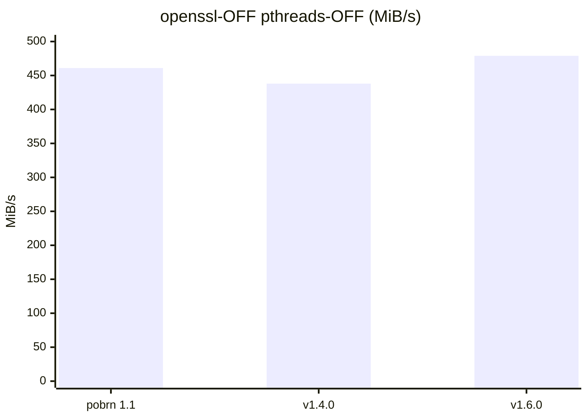
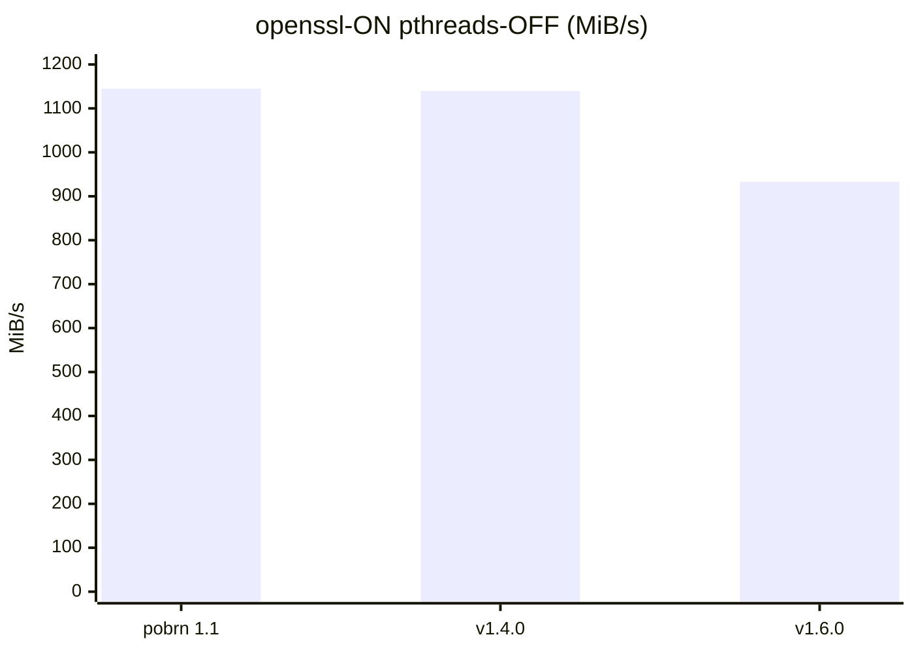

# MKTorrent

[](https://github.com/tomcdj71/mktorrent/releases)


A simple command-line utility to create BitTorrent metainfo files.

## Features

- Multi-threaded hashing (OpenSSL or bundled SHA-1)
- Large files, multi-target / `--from-file` / `--stdin`
- Piece length as exponent or `K`/`M`/`G` byte sizes
- Optional announce (DHT-only), web seeds, DHT `--node`
- Private flag, source, comment, cross-seed
- Include/exclude filters, `--skip-hidden`, `--no-follow-symlinks`
- Opt-in `--direct-io` and `--io-uring` (liburing)
- JSON create summary (`--json`)
- Linux only

## Quick Start

1. [Install MKTorrent](docs/Installation-Guide.md)
2. Create a torrent:
   ```bash
   mktorrent -a http://tracker.example.com/announce -o output.torrent input_file
   ```

## Performance

Warm **2 GiB**, `-l 20` (1 MiB pieces), one 8-core laptop, page cache hot. Median of 5 runs, **MiB/s** (higher is better).

Each chart compares [pobrn/mktorrent](https://github.com/pobrn/mktorrent) **1.1** (same `USE_OPENSSL` / `USE_PTHREADS` flags) to this fork’s **v1.4.0** and **v1.6.0** `.deb`s for that config. Builds without pthreads have no `-t` (single-threaded only).

### `openssl-OFF` `pthreads-OFF`

| | MiB/s |
|--|------:|
| pobrn 1.1 | 461 |
| v1.4.0 | 438 |
| v1.6.0 | 479 |



### `openssl-ON` `pthreads-ON`

| | `-t 1` | `-t 8` |
|--|-------:|-------:|
| pobrn 1.1 | 1328 | 1259 |
| v1.4.0 | 1074 | 1064 |
| v1.6.0 | 1330 | 2062 |

```mermaid
xychart-beta
    title "openssl-ON pthreads-ON (MiB/s)"
    x-axis ["pobrn 1.1", "v1.4.0", "v1.6.0"]
    y-axis "MiB/s" 0 --> 2100
    bar [1328, 1074, 1330]
    bar [1259, 1064, 2062]
```



First series: `-t 1`. Second: `-t 8`.

### `openssl-OFF` `pthreads-ON`

| | `-t 1` | `-t 8` |
|--|-------:|-------:|
| pobrn 1.1 | 455 | 744 |
| v1.4.0 | 421 | 776 |
| v1.6.0 | 479 | 1230 |

```mermaid
xychart-beta
    title "openssl-OFF pthreads-ON (MiB/s)"
    x-axis ["pobrn 1.1", "v1.4.0", "v1.6.0"]
    y-axis "MiB/s" 0 --> 1300
    bar [455, 421, 479]
    bar [744, 776, 1230]
```



First series: `-t 1`. Second: `-t 8`.

### `openssl-ON` `pthreads-OFF`

| | MiB/s |
|--|------:|
| pobrn 1.1 | 1145 |
| v1.4.0 | 1140 |
| v1.6.0 | 933 |



More on hashing paths: [Hashing and I/O](docs/Hashing-IO.md).

## Documentation

See [docs/Home.md](docs/Home.md):

- [Installation Guide](docs/Installation-Guide.md)
- [Command Line Options](docs/Command-Line-Options.md)
- [Hashing and I/O](docs/Hashing-IO.md)
- [Security](docs/Security.md)
- [Testing](docs/Testing.md)
- [Release Packages](docs/Release-Packages.md)
- [Release Notes](docs/Release-Notes.md)

## Support

1. Search [existing issues](https://github.com/tomcdj71/mktorrent/issues)
2. Open a new issue with detailed information

## License

MKTorrent is released under the GNU General Public License v3.0. See the [LICENSE](LICENSE) file for details.

## Building a Debian Package

### Using FPM (Recommended)

[FPM](https://github.com/jordansissel/fpm) provides a simplified way to build Debian packages without needing to create a complete Debian packaging structure.

#### Prerequisites

Install FPM and required dependencies:

```bash
sudo apt-get update
sudo apt-get install ruby ruby-dev build-essential
sudo gem install fpm
```

#### Build and Package

1. First, compile mktorrent:

```bash
# Clone the repository
git clone https://github.com/tomcdj71/mktorrent.git
cd mktorrent

# Build with your desired options
cmake -B build \
  -DMKTORRENT_LONG_OPTIONS=ON \
  -DMKTORRENT_PTHREADS=ON \
  -DMKTORRENT_OPENSSL=ON \
  -DCMAKE_BUILD_TYPE=Release

cmake --build build
```

2. Create staging directory structure:

```bash
# Create necessary directories
mkdir -p staging/usr/bin
mkdir -p staging/usr/share/man/man1

# Copy binary to staging
cp build/mktorrent staging/usr/bin/

# Copy man page
cp man/mktorrent.1 staging/usr/share/man/man1/

# Make executable
chmod +x staging/usr/bin/mktorrent
```

3. Build the .deb package with FPM:

```bash
# Extract version from CMakeLists.txt
VERSION=$(awk '/project\(mktorrent/,/\)/ { if ($1 ~ /VERSION/) print $2 }' CMakeLists.txt | tr -d ')')

# Create the package
fpm -s dir -t deb -C staging \
  --name mktorrent \
  --version $VERSION \
  --architecture amd64 \
  --description "Simple command-line torrent file creator" \
  --url "https://github.com/tomcdj71/mktorrent" \
  --maintainer "Your Name <your.email@example.com>" \
  --license "Public Domain" \
  --depends "libc6" \
  --depends "libssl3" \
  --deb-compression xz \
  --deb-priority optional \
  --category net \
  usr/bin usr/share/man
```

This will create a file named `mktorrent_$VERSION_amd64.deb` in your current directory.

4. Install and test the package:

```bash
sudo dpkg -i mktorrent_*.deb
mktorrent --version
```

#### Advanced Options

For smaller packages, you can strip debug symbols:

```bash
# Strip debug symbols
strip --strip-unneeded staging/usr/bin/mktorrent

# Optionally compress with UPX for even smaller binaries
sudo apt-get install upx
upx --best --lzma staging/usr/bin/mktorrent
```

You can add additional metadata to better describe the build configuration:

```bash
# Add build options to the description
fpm -s dir -t deb -C staging \
  --name mktorrent \
  --version $VERSION \
  --architecture amd64 \
  --description "Simple command-line torrent file creator with OpenSSL=$OPENSSL and pthreads=$PTHREADS support" \
  # ... rest of options
```

This approach mirrors the build process used in the project's GitHub Actions workflow.
